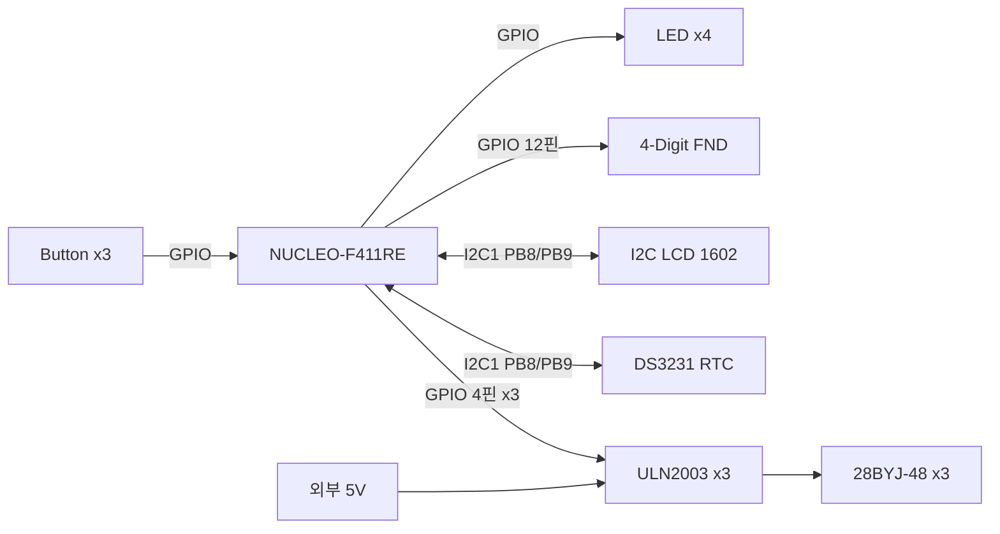

# proj_analog_clock_stopwatch

STM32F411RE(NUCLEO-F411RE)와 28BYJ-48 스텝모터 3개로 만든 **아날로그 시계 + 스톱워치**입니다.
DS3231 RTC에서 읽은 시간을 시침·분침·초침 바늘로 보여주고, 버튼으로 스톱워치 모드로 전환해 FND에 측정 시간을 표시합니다.

<!-- 동작 영상 GIF -->
<!--  -->

## 주요 기능

| 모드 | 동작 |
|---|---|
| 시계 모드 | DS3231에서 현재 시간을 읽고, 스텝모터 3개가 시침·분침·초침을 구동, LCD에 날짜·시간 표시 |
| 스톱워치 모드 | 타이머 인터럽트로 시간 측정, FND에 분 : 초 : msec 표시, 시작 · 정지 · 초기화 |

| 버튼 | 시계 모드 | 스톱워치 모드 |
|---|---|---|
| MODE | 스톱워치 모드로 전환 | 시계 모드로 전환 |
| RUN_STOP | - | 시작 / 정지 |
| CLEAR | - | 0으로 초기화 (정지 상태에서만) |

## 하드웨어

### 부품 목록 (BOM)

| 부품 | 역할 | 인터페이스 | 수량 |
|---|---|---|---|
| NUCLEO-F411RE (STM32F411RET6) | 메인 MCU, Cortex-M4 100MHz | - | 1 |
| 28BYJ-48 | 시침·분침·초침 구동 스텝모터 (5V) | ULN2003 경유 | 3 |
| ULN2003AN 드라이버 보드 | 모터 코일 전류 증폭 | GPIO 4핀 × 3 | 3 |
| DS3231 RTC 모듈 (ZS-042) | 실시간 시계, 배터리 백업 | I2C (0x68) | 1 |
| I2C LCD (LCD1602 + PCF8574) | 날짜·시간 표시 | I2C | 1 |
| 4자리 FND (공통 캐소드) | 스톱워치 표시 | GPIO 12핀 | 1 |
| 택트 스위치 / LED | 사용자 입력 / 상태 표시 | GPIO | 3 / 4 |
| 브레드보드 전원 모듈 | 모터 전용 외부 5V | - | 1 |
| 브레드보드 (WBU-208), 점퍼선, 저항 | 회로 연결 (LED 220Ω, 버튼 4.7kΩ, FND 330Ω) | - | - |

### 연결 구조

- 모터 전류(약 240mA)가 GPIO 출력 전류보다 커서 모터 전원은 외부 5V로 분리
- 외부 전원 GND와 NUCLEO GND는 공통으로 연결

### 핀맵

| 부품 | 신호 | MCU 핀 |
|---|---|---|
| 스텝모터 1 | IN1 ~ IN4 | PA0 · PA1 · PA4 · PB0 |
| 스텝모터 2 | IN1 ~ IN4 | PC10 · PC11 · PC12 · PD2 |
| 스텝모터 3 | IN1 ~ IN4 | PC5 · PC6 · PC8 · PC9 |
| I2C1 (LCD, DS3231) | SCL / SDA | PB8 / PB9 |
| Button | MODE / RUN_STOP / CLEAR | PC0 · PC1 · PC3 |
| LED | LED1 ~ LED4 | PB15 · PB14 · PB13 · PC4 |
| USART2 (디버그 printf) | TX / RX | PA2 / PA3 |

| FND | D1 | D2 | D3 | D4 | A | B | C | D | E | F | G | DP |
|---|---|---|---|---|---|---|---|---|---|---|---|---|
| MCU 핀 | PA5 | PB6 | PC7 | PA10 | PA6 | PA9 | PB5 | PB10 | PA8 | PA7 | PB3 | PB4 |

## 소프트웨어

### 개발 환경

| 항목 | 내용 |
|---|---|
| IDE | STM32CubeIDE 2.2.0 |
| 코드 생성 | STM32CubeMX 6.18.1 |
| 라이브러리 | STM32 HAL |
| 클럭 | HSE 8MHz → PLL (÷4, ×100, ÷2) → SYSCLK 100MHz, APB1 50MHz (타이머 100MHz), APB2 100MHz |

### SW 구조

각 계층은 바로 아래 계층만 호출하도록 나눴습니다. 부품이 바뀌어도 해당 Driver만 수정하면 됩니다.

| 계층 | 구성 |
|---|---|
| Application | ap_main (모드 전환 · Orchestrator) |
| Service | TimeClock, StopWatch, Display |
| Driver | Button, LED, FND, LCD, DS3231, StepMotor ×3, TIM |
| HAL | GPIO, I2C, TIM |
| HW | Button · LED · FND, LCD · DS3231, ULN2003 · 모터 |

- **Core / UI 분리**: Core(TimeClock, StopWatch)는 시간 데이터만 만들고, 어떻게 보여줄지는 Display가 결정합니다. Orchestrator(ap_main)가 Core에 데이터를 요청해서 Display에 전달합니다.

### 타이머 설정

| 타이머 | 버스 (클럭) | PSC | ARR | 인터럽트 주기 | Preload | 용도 |
|---|---|---|---|---|---|---|
| TIM3 | APB1 (100MHz) | 99 | 999 | 1ms | Disable | 스톱워치 msec · FND 자리 전환 |
| TIM4 | APB1 (100MHz) | 1000-1 | 1000-1 | 10ms | Disable | 시계 · 버튼 처리 |
| TIM9 | APB2 (100MHz) | 100-1 | 3000-1 | 3ms | Enable | 스텝모터 스텝 간격 |

- 주기 = (PSC + 1) × (ARR + 1) ÷ 100MHz

### 스톱워치 상태

| 현재 상태 | 입력 | 다음 상태 |
|---|---|---|
| STOP | RUN_STOP | RUN |
| RUN | RUN_STOP | STOP |
| STOP | CLEAR | CLEAR → STOP |

- CLEAR는 STOP 상태에서만 진입해서, 측정 중에 실수로 초기화되지 않게 했습니다.

## 바늘 구동 방식

- 28BYJ-48을 하프스텝(8단계)으로 구동하며, 출력축 1바퀴를 4096스텝으로 계산했습니다.
- 한 칸 간격 = 한 바퀴 시간 ÷ 4096

| 바늘 | 한 바퀴 | 한 칸 간격 (이론) | 실제 설정 | 하루 누적 오차 |
|---|---|---|---|---|
| 초침 | 60 s | 14.6484375 ms | 14.648 ms | 약 2.58 s |
| 분침 | 3,600 s | 878.90625 ms | 878.88 ms (× 60) | 약 2.58 s |
| 시침 | 43,200 s | 10,546.875 ms | 10,546.56 ms (× 720) | 약 2.58 s |

- 분침·시침 간격을 초침 간격의 정확한 배수로 잡아서, 세 바늘이 같은 비율로 움직여 서로 어긋나지 않습니다.
